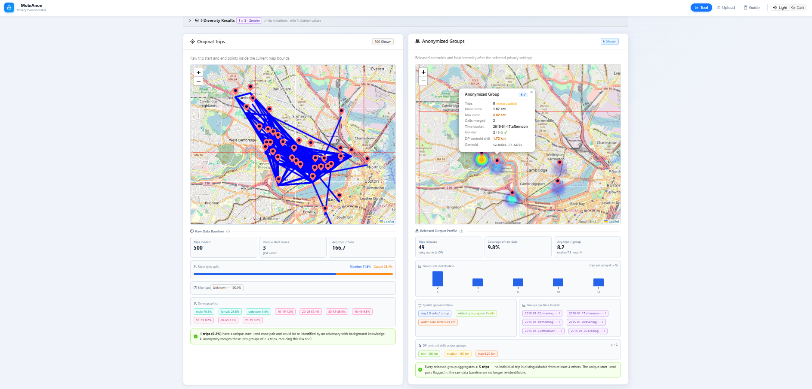
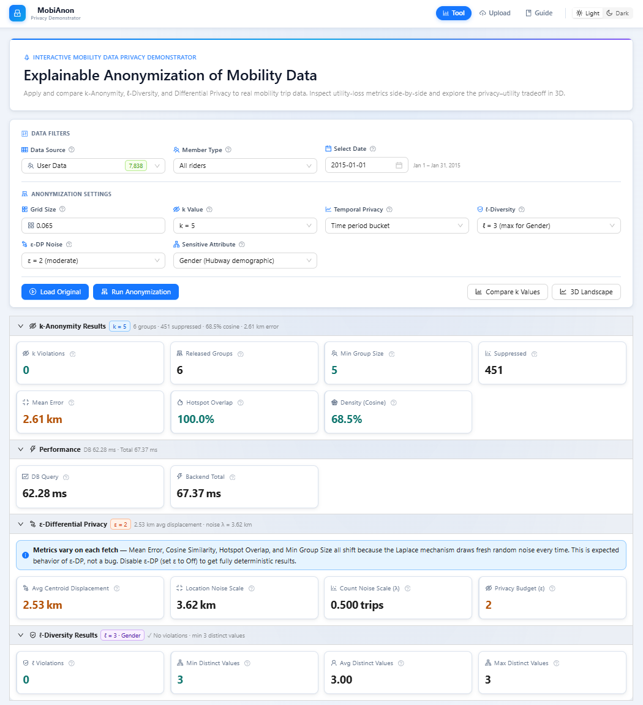
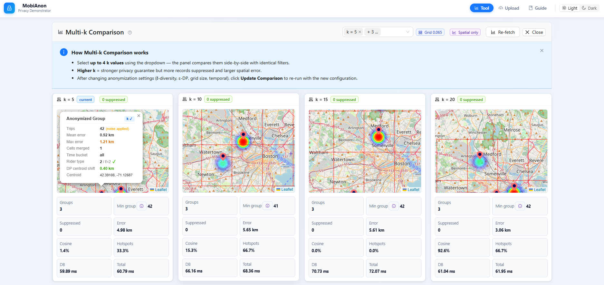
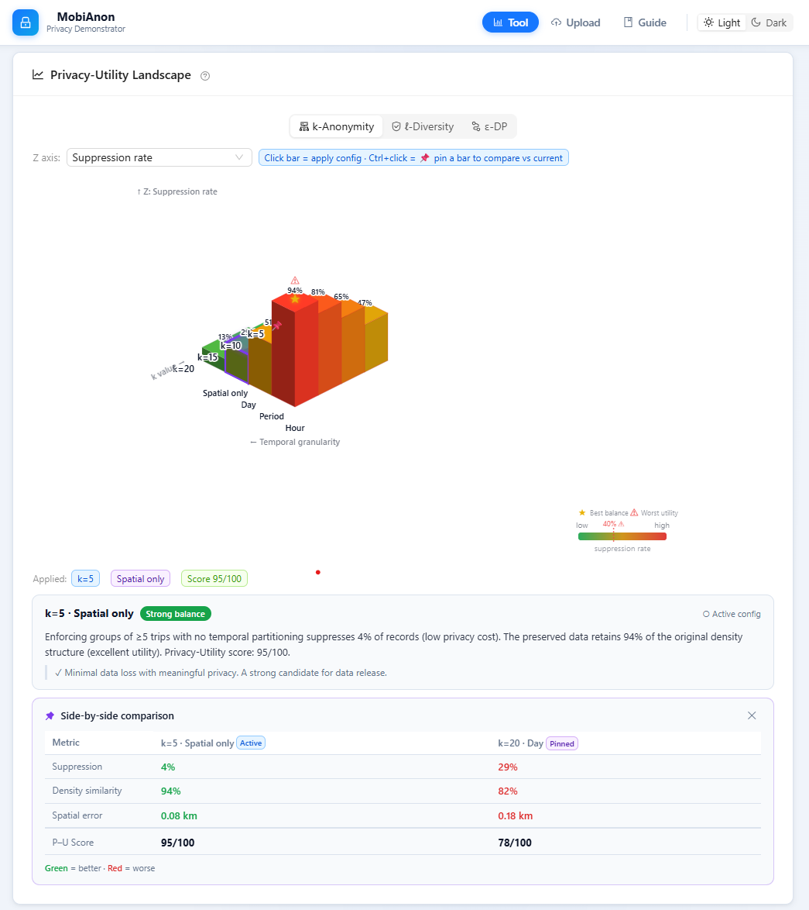
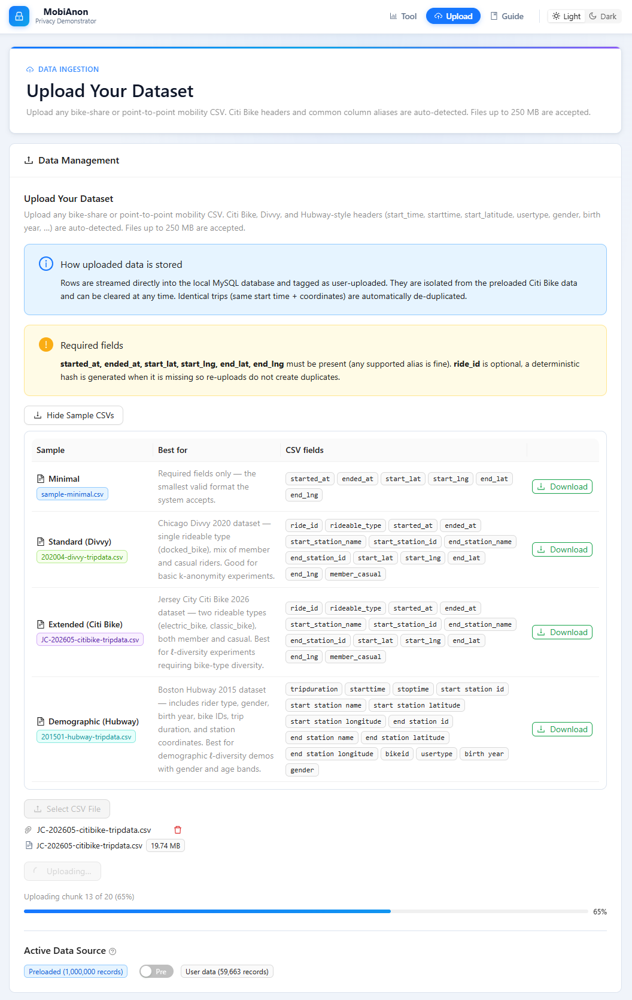
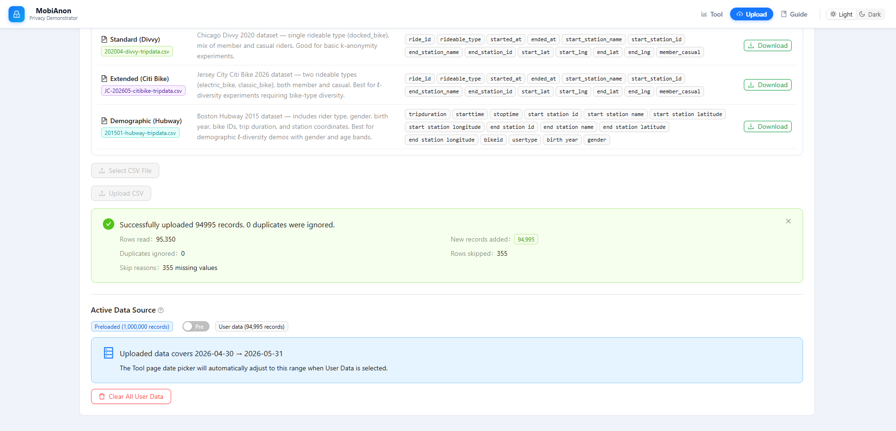
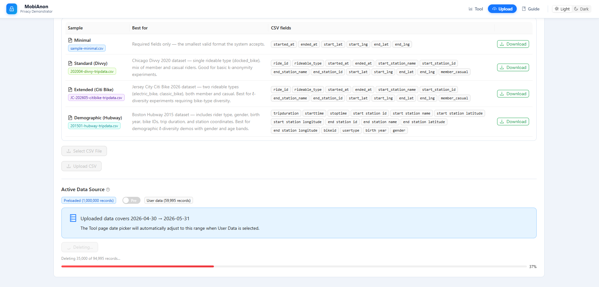
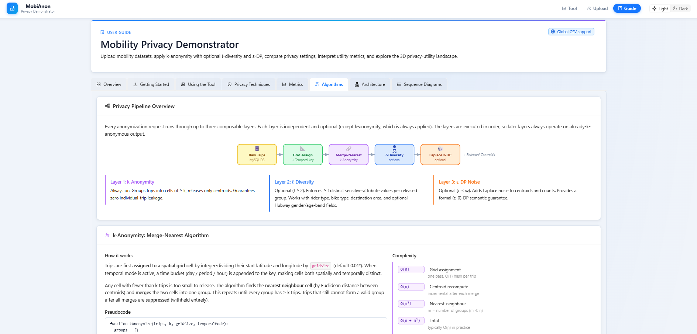

# MobiAnon — Interactive Mobility Privacy Demonstrator

**Master's Thesis & Independent Software Development**  
**Developer:** Haris Mustafa  
**University:** University of Bamberg  
**Degree:** M.Sc. International Software Systems Science

## Overview

MobiAnon is a full-stack research application designed to
explore the privacy–utility trade-off in mobility data.

It provides interactive geographic visualizations of
original and anonymized trip data, configurable privacy
techniques, quantitative utility metrics, and benchmark
tools for evaluating anonymization approaches.

The application was independently designed, implemented,
and extended by Haris Mustafa, originating from his
Master's thesis at the University of Bamberg.

## Academic Background

The original Master's thesis investigated how
interactive visualizations can help users understand
spatial k-anonymity and the relationship between
location privacy and data utility.

The thesis included a user study with 16 participants.

The software was subsequently extended with:

- Spatial and spatio-temporal k-anonymity
- Configurable l-diversity
- Experimental Laplace-based noise mechanisms
- Interactive privacy–utility comparisons
- CSV dataset upload and management
- Multiple mobility dataset formats
- Automated benchmarking and evaluation
- Interactive 3D privacy–utility visualization

All software implementation and extensions in this
repository were developed by Haris Mustafa.

## Research Publication

**Title:** MobiAnon: An Interactive Demonstrator for
Exploring the Privacy–Utility Trade-off in Mobility Data

**Authors:**
- Muhammad Tayyab Shafique
- Haris Mustafa
- Abeera Ayesha Riaz

**Conference:** SKILL 2026, Dresden, Germany

The research paper is a collaborative academic
publication with three authors. Software development
and publication authorship are distinct contributions.

## Technology Stack

- Frontend: React, JavaScript, Vite, Leaflet
- Backend: Node.js, Express.js
- Database: MySQL
- Data Processing: CSV import and validation
- Privacy Methods: k-anonymity, l-diversity,
  experimental Laplace-based noise
- Evaluation: Privacy/utility metrics and benchmarks

## Visual Overview

The submitted paper focuses on the architecture, anonymization pipeline, and benchmark results. The screenshots below show the application interface that reviewers can inspect when they open this repository.

### 1. Main Tool: Original vs Anonymized Trips



This is the core MobiAnon interaction: raw mobility trips are shown next to the anonymized release so users can visually compare spatial patterns and utility loss.

### 2. Privacy Settings and Metrics



The controls expose grid size, k, temporal privacy, l-diversity, sensitive attributes, and epsilon-DP noise. The metric cards summarize privacy validity and utility loss in the same view.

### 3. Multi-k Comparison



The comparison panel runs the same query for multiple k values, helping users see how stronger anonymity changes suppression, spatial error, density similarity, and hotspot overlap.

### 4. 3D Privacy-Utility Landscape



The 3D landscape gives an interactive overview of privacy-utility tradeoffs across k-anonymity, l-diversity, and epsilon-DP scenarios.

### 5. Upload and Data Management: Resumable Import



The upload page supports user mobility CSV files, sample downloads, resumable chunk upload, and duplicate handling. This screenshot shows a Citi Bike sample being imported in chunks while the application keeps upload progress visible.

### 6. Upload and Data Management: Import Summary



After upload, the page reports rows read, records inserted, duplicate records, skipped rows, validation details, the active user-data count, and the detected date range that will drive the Tool page date picker.

### 7. Upload and Data Management: Clearing User Data



Uploaded data is isolated from the preloaded demo data and can be cleared safely. The delete workflow streams batch progress so users can see how many records have been removed.

### 8. In-App Guide



The guide explains supported CSV formats, privacy models, metrics, and application workflow for users who are not privacy experts.

## Reproducibility

For setup, Laragon/MySQL instructions, database creation, data import, benchmark commands, report generation, and known limitations, see:

[REPRODUCIBILITY.md](./REPRODUCIBILITY.md)

That guide is the primary source of truth for reproducing the current version of the project.

## Quick Start
**Prerequisite:** Configure MySQL and create the
database using the instructions in
[REPRODUCIBILITY.md](./REPRODUCIBILITY.md).
```bash
npm install
cd bicycle-be
npm install
cd ..
npm run dev
```

Frontend:

```text
http://localhost:5173
```

Backend:

```text
http://localhost:5000
```

## Important Paths

| Path | Purpose |
| --- | --- |
| `src/components/Map/MapCompare.jsx` | Main comparison UI |
| `src/components/Upload/CSVUpload.jsx` | CSV upload/data-source UI |
| `src/components/Viz3D/PrivacyLandscape.jsx` | Interactive 3D privacy-utility landscape |
| `src/pages/Guide.jsx` | In-app user guide |
| `bicycle-be/routes/bicycleRoute.js` | Trip/anonymization API routes |
| `bicycle-be/routes/uploadRoute.js` | CSV upload, sample download, source metadata, and delete API |
| `bicycle-be/services/anonymization.js` | k-anonymity, l-diversity, DP noise, metrics, and baseline methods |
| `bicycle-be/scripts/evaluateAnonymization.js` | Offline anonymization benchmark |
| `bicycle-be/scripts/generateBenchmarkReport.js` | Paper report/figure generation |
| `bicycle-be/scripts/benchmarkDbQueries.js` | Live database query benchmark |
| `bicycle-be/db/create-trips-table.sql` | Clean MySQL schema setup |
| `bicycle-be/db/performance-indexes.sql` | Live query performance indexes |
| `bicycle-be/paper-results/` | Generated paper-facing reports and figures |

## Verification

```bash
npm run build
cd bicycle-be
npm run benchmark:anonymization
npm run report:benchmark
npm run benchmark:db
npm run report:db
```

On managed Windows laptops, `npm run build` may need to be run in a normal terminal if a sandbox blocks the esbuild worker process.

## Scope Notes

- The app expects point-to-point trips with start/end timestamps and coordinates.
- Station-ID-only data, zone-only data, and full GPS trajectories need preprocessing before import.
- The epsilon-DP layer is a per-query demonstrator mechanism and does not include full privacy accounting across repeated API calls.
- Authentication components exist in the codebase, but the main Tool, Upload, and Guide routes are currently public.
